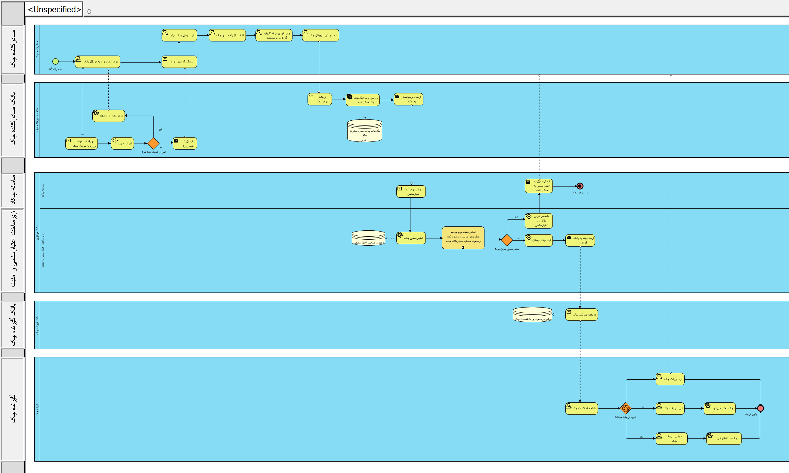

# Digital-Cheque-Process-BPMN
End-to-End BPMN 2.0 Business Process Modeling &amp; Requirements Analysis for Digital Cheque Systems
# End-to-End Business Process Modeling: Digital Cheque Issuance & Transfer System


## 📌 Project Overview
This repository contains an end-to-end Business Process Engineering and Requirements Analysis project for a **Digital Cheque Issuance and Transfer Ecosystem** (modeled around nationwide centralized clearing infrastructures like Chakad). 

The goal of this project is to standardize multi-party banking workflows, define robust exception-handling scenarios, and establish data governance alignments through **RACI** frameworks.

---

## 🏗 Key Deliverables & Architecture

### 1. Collaboration Diagram (BPMN 2.0)
The workflow involves 5 independent participants (Pools) communicating exclusively via **Message Flows**:
- **Issuer (Drawer):** Customer interface for request initiation, payload capture, and digital signature authorization.
- **Issuing Bank:** Channel gateway (Mobile/Internet Banking) and Core Banking integration layer.
- **Central Clearing Infrastructure (Central Bank / Chakad):** Centralized ledger, dynamic business rule validation (credit limits, active Sheba/identity checks), digital certificate validation, and status lifecycle management.
- **Acquiring Bank (Receiver's Bank):** Inbound message dispatch and push-notification routing.
- **Receiver (Beneficiary):** Verification, decision gateway (`Accept` vs. `Reject`), and pending status monitoring.

### 2. Exception Handling & Resilience
- **Validation Failure (Boundary Error Events):** Instant synchronous rejection and feedback to the issuer when legal or operational rules fail.
- **Beneficiary Inaction vs. Explicit Rejection:** Handled via distinct paths (`Pending Confirmation` with timer controls vs. `Explicit Rejection` triggering transaction cancellation and notification).
- **Audit Trails:** Immutable status logging at every state transition.

### 3. Governance & Alignment Matrix
- **RACI Matrix:** Clear accountability distribution across all banking and regulatory entities.
- **CRUD Matrix:** Entity-level permissions on data objects (`ChequeRequest`, `ValidationResult`, `DigitalChequeRecord`, `StatusLog`).

---

## 🛠 Tech & Methodological Stack
- **Modeling Tool:** Visual Paradigm
- **Standard:** BPMN 2.0 (Business Process Model and Notation)
- **Requirements Engineering:** Functional (FR), Non-Functional (NFR), Security (SEC), and Legal/Compliance (LEG) specifications.
- **Governance:** RACI Matrix

## 📊 Process Diagram Overview


## 📊 RACI Matrix
Assets/RACI Matrix.png
---

## 📂 Repository Structure
```text
├── docs/
│   ├── Business_Requirements_Document.docx
├── models/
│   └── Digital_Cheque_Process.vpp      # Native Visual Paradigm project file
└── assets/
├── bpmn_collaboration_diagram.png # High-res process export
└── raci_matrix.png
